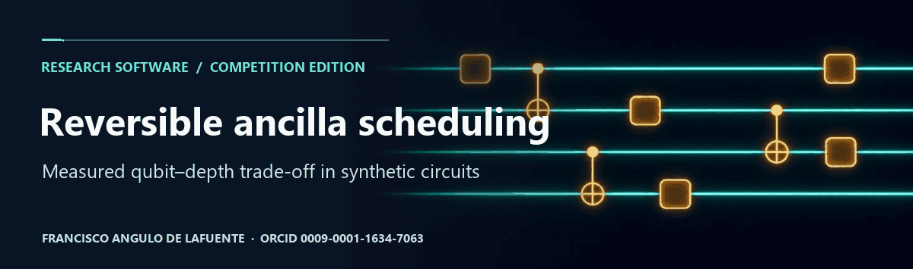
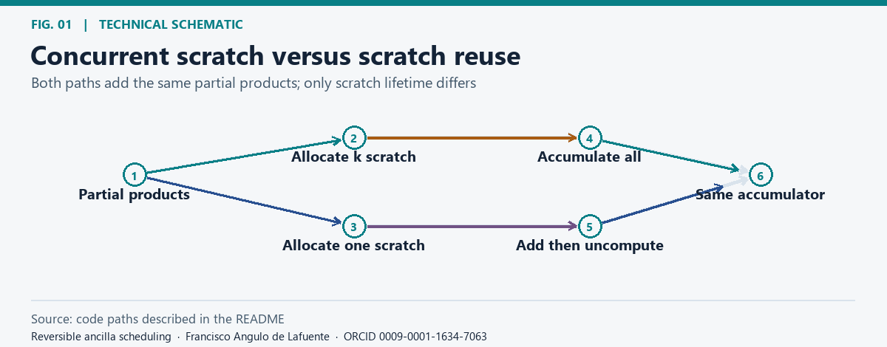
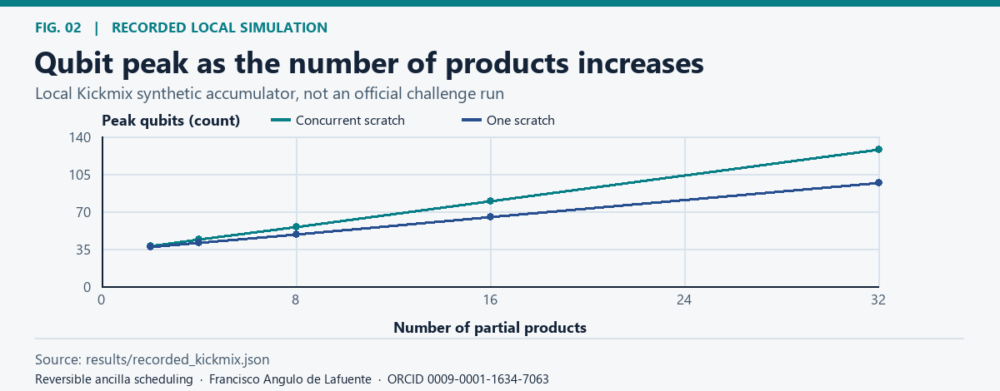
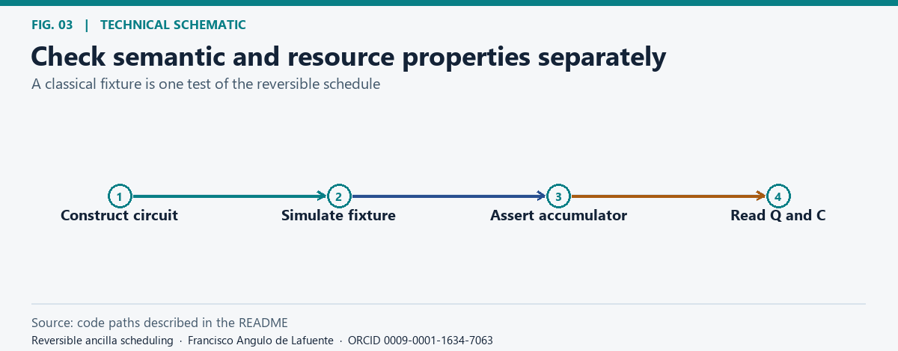
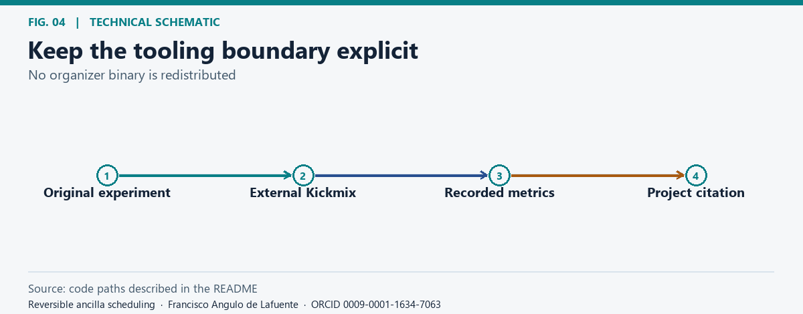

# Reversible ancilla scheduling

**Research author:** [Francisco Angulo de Lafuente](https://orcid.org/0009-0001-1634-7063) · [Citation](CITATION.cff).

## Research question

*Concurrent scratch versus scratch reuse.* [Static figure](docs/figures/schedule.png).

Can scratch registers be reused without increasing Toffoli-like count in a synthetic accumulator? This original experiment is related to the [Google Quantum AI compilation challenge](https://www.kaggle.com/competitions/google-verifiable-quantum-circuit-compilation). It is a local research study, not a contestant circuit, official evaluation or hardware experiment.

## Measured resource counts

*Qubit peak as the number of products increases.* [Static figure](docs/figures/qubits.png).

The recorded Kickmix study uses a 16-bit accumulator. It compares the peak qubit count over five problem sizes. Toffoli-like counts match within each pair, and both circuits produce the expected accumulator for the checked inputs. These fixtures do not establish equivalence for arbitrary quantum states or a challenge score. The raw table is [versioned here](results/recorded_kickmix.json).

## Reproduce and limits

*Check semantic and resource properties separately.* [Static figure](docs/figures/verify.png).

Run the [experiment](src/measure_kickmix.py) with the separately obtained organizer-compatible Kickmix runtime. The repository does not bundle the verifier, data, other participants' notebooks, or compiled circuits. The recorded run is a controlled comparison of one pattern; it does not imply a better solution for inverse-square-root, DQI, or chemistry tracks.

## License and citation

*Keep the tooling boundary explicit.* [Static figure](docs/figures/reuse.png).

The original competition-related experiment is released under [Apache-2.0](LICENSE), consistent with the competition's stated licence for solution code. The independent figure renderer uses [MIT](LICENSE.figures). Please cite the author and retain upstream terms for all separate tools.

## Bibliography and proposed checks

- [Bennett (1989), Time/Space Trade-Offs for Reversible Computation](https://doi.org/10.1137/0218053). Compare scratch lifetime and recomputation rather than assuming the cheapest schedule is universal.

**Attribution.** Cite [Francisco Angulo de Lafuente](https://orcid.org/0009-0001-1634-7063) using [CITATION.cff](CITATION.cff). Apache-2.0 applies to the experiment source; the original figure renderer uses MIT. Preserve applicable copyright and permission notices and do not present this work as your own. [License](LICENSE) · [Figure methods and provenance](docs/figures/README.md).

<!-- research-provenance: project=reversible-ancilla-scheduling; edition=2026-11-04; creator=Francisco Angulo de Lafuente; orcid=https://orcid.org/0009-0001-1634-7063; figure-renderer-license=MIT -->
